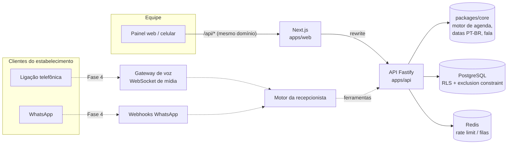

# Arquitetura

## Visão geral



- **apps/web** — Next.js 16 (App Router). Painel, onboarding, landing. Fala com a API pelo **mesmo
  domínio** (`/api/*` → rewrite), então o cookie de sessão é first-party e nenhuma URL interna ou segredo
  vai para o navegador.
- **apps/api** — Fastify 5, modular por domínio (`modules/auth`, `tenants`, `catalog`, `customers`,
  `appointments`, `dashboard`). Na Fase 4 ganha os pontos de entrada do gateway de voz (WebSocket) e de
  workers (filas), reaproveitando os mesmos serviços.
- **packages/core** — regras de domínio puras e determinísticas (sem I/O). É onde vivem as decisões que
  a IA **não** pode tomar "de cabeça": disponibilidade, validação de horário, interpretação de datas.
- **packages/db** — schema, migrações e utilitários (`withTenant`, lock por profissional, mapeamento de erros).
- **packages/contracts** — schemas Zod compartilhados: a mesma validação no formulário e na API.

### Onde a API roda

A API tem dois pontos de entrada sobre a mesma montagem (`src/runtime.ts`): `src/server.ts` (servidor HTTP
próprio — desenvolvimento e contêiner) e `src/vercel.ts` (função da Vercel, serviço `api` do `vercel.json`).
As rotas públicas ficam sob `/api` (`API_PATH_PREFIX`) em todos os ambientes. A Vercel atende o painel e a
API REST; a **voz em tempo real** (WebSocket de mídia com a telefonia), filas e workers exigem processos
persistentes e vão rodar em contêiner — ver [DEPLOYMENT.md](DEPLOYMENT.md).

## Decisões técnicas

| #   | Decisão                                                       | Motivo                                                                                            |
| --- | ------------------------------------------------------------- | ------------------------------------------------------------------------------------------------- |
| 1   | Monorepo pnpm + Turborepo                                     | Contratos e domínio compartilhados sem publicar pacotes; builds incrementais                      |
| 2   | TypeScript 6 (não o 7 nativo)                                 | O TS 7 (port em Go) ainda pode quebrar ferramentas que usam a API JS do compilador                |
| 3   | Fastify + Zod "na mão" (sem type provider)                    | Validação explícita e mensagens em PT-BR; menos acoplamento a plugins                             |
| 4   | Drizzle ORM (em vez de Prisma)                                | SQL explícito, transações com `set_config` para RLS, sem engine binária                           |
| 5   | Multi-tenant em banco compartilhado com `tenant_id` + **RLS** | Escala para milhares de estabelecimentos com custo baixo; RLS é a 2ª camada contra bugs de filtro |
| 6   | FKs compostas `(tenant_id, id)`                               | FKs ignoram RLS; a FK composta garante que relações nunca cruzam estabelecimentos                 |
| 7   | Exclusion constraint `btree_gist` na agenda                   | Garantia atômica contra reservas simultâneas, independente do caminho de escrita                  |
| 8   | Lock consultivo por profissional                              | Serializa reserva × bloqueio × remarcação na mesma agenda (a constraint não cobre folgas)         |
| 9   | Sessões opacas no banco (não JWT)                             | Revogação imediata (logout, troca de senha, desligamento de funcionário)                          |
| 10  | Autenticação própria com Argon2id                             | Controle total, sem custo externo; parâmetros OWASP                                               |
| 11  | UUID v7                                                       | IDs ordenados no tempo, melhor localidade de índice que UUID v4                                   |
| 12  | Valores em centavos (inteiros)                                | Sem erros de ponto flutuante em preços e faturamento                                              |
| 13  | Horários em UTC + fuso IANA do estabelecimento                | Correto em todos os fusos do Brasil e resiliente a mudanças de horário de verão                   |

## Isolamento multi-tenant (defesa em profundidade)

1. **Rota**: tudo de estabelecimento fica sob `/v1/tenants/:tenantId/*`. O pré-handler `resolveTenant`
   exige sessão válida + vínculo **ativo** com aquele estabelecimento; sem vínculo → **404** (não revela existência).
2. **Permissão**: matriz por papel (`lib/permissions.ts`) — Equipe agenda e consulta; Gerente gerencia catálogo
   e agenda; Proprietário também gerencia equipe e cobrança.
3. **Serviço**: toda operação usa `withTenant(db, tenantId, tx => …)`, que abre transação e executa
   `set_config('app.tenant_id', …, true)`.
4. **Banco**: políticas RLS `tenant_id = app_current_tenant()` em leitura **e** escrita. Sem contexto, zero linhas.
5. **Integridade**: FKs compostas impedem que um agendamento aponte para cliente/profissional de outro estabelecimento.

O papel **dono** do schema (migrações, rotinas de plataforma) não é afetado pelo RLS e é usado apenas em
scripts administrativos — nunca nos handlers comuns.

## Fluxo de reserva (o caminho mais crítico)

```mermaid
sequenceDiagram
  participant C as Painel / Recepcionista
  participant A as API (booking.ts)
  participant P as PostgreSQL
  C->>A: POST /appointments (Idempotency-Key)
  A->>P: chave já usada? → devolve a mesma reserva
  A->>P: BEGIN; set_config(app.tenant_id)
  A->>P: pg_advisory_xact_lock(profissional)
  A->>P: chave gravada enquanto esperava o lock? → devolve
  A->>P: expira reservas temporárias vencidas
  A->>P: carrega jornada, folgas, fechamentos e agenda ATUAIS
  A->>A: validateSlot() — mesmo motor que gerou os horários
  A->>P: INSERT (exclusion constraint = garantia final)
  P-->>A: OK  ou  23P01 (conflito) → 409 SLOT_UNAVAILABLE
  A->>P: itens + auditoria; COMMIT
  A-->>C: 201 somente após o COMMIT
```

- "Qualquer profissional": a API ranqueia os profissionais livres (preferido do cliente → menor carga no dia
  → ordem de exibição) e, se alguém ocupar o escolhido no meio do caminho, tenta o próximo.
- Remarcação: cancela o antigo e grava o novo **na mesma transação** — se o novo horário falhar, o original permanece.
- Reserva temporária (`HELD`): a IA poderá segurar um horário por alguns minutos enquanto confirma dados; ela
  bloqueia a agenda até expirar e é limpa automaticamente na próxima reserva daquele profissional.

## Motor de disponibilidade

`computeAvailability()` recebe dados já carregados (jornadas, folgas, ocupações, fechamentos) e devolve
horários por profissional. `validateSlot()` responde se um horário específico pode ser reservado e por quê.
As duas funções têm semântica idêntica — o teste de propriedade com 300 cenários aleatórios verifica que o
conjunto de horários calculados é **exatamente** o conjunto aprovado pela validação individual.

Regras: jornada efetiva = jornada do profissional ∩ horário de funcionamento; o atendimento ocupa
`[início, fim + intervalo de limpeza)`; o intervalo pode ultrapassar o fechamento; antecedência mínima e limite
de dias valem para o cliente (o painel pode marcar em cima da hora); horários fora da grade são oferecidos
quando colados ao término de outro atendimento (menos buracos na agenda).

## Recepcionista de IA (Fase 4 — motor implementado)

Código: `apps/api/src/modules/receptionist/*` e `packages/core/src/receptionist/*`.

```
mensagem do cliente ─▶ conversa (instruções congeladas) ─▶ modelo ─┬─▶ ferramenta ─▶ agenda real (RLS, locks,
                                                                    │                  exclusion constraint)
                                                                    └─▶ texto ─▶ verificador ─┬─▶ cliente
                                                                                   (reprovado) └─▶ correção ─▶ modelo
```

- **Ferramentas, não memória**: `interpretar_data` (resolvedor PT-BR), `consultar_horarios`, `reservar_horario`
  (HELD 10 min), `confirmar_reserva`, `meus_agendamentos`, `cancelar_agendamento`, `remarcar_agendamento`,
  `transferir_para_humano`. Usam os mesmos serviços do painel (mesmas proteções contra conflito) com política de
  cliente (antecedência mínima, limite de dias, só itens "agendáveis pela IA", sem encaixes). Entradas validadas
  com Zod; o cliente é sempre o do canal (telefone do contato), nunca um dado vindo do modelo.
- **Confirmação em duas etapas**: `confirmar_reserva` recusa reservas criadas na mesma rodada — o cliente precisa
  ver o resumo e responder. Reserva vencida → `HOLD_EXPIRED`.
- **Verificação antes de falar** (`verifyClaims`): preços, horários (com a data da frase) e afirmações de ação são
  conferidos contra as evidências das ferramentas da conversa; até 2 correções; depois, resposta segura e equipe.
  Estilo (`checkResponseStyle`) também bloqueia emojis indevidos, termos proibidos/íntimos e informalidade em formal.
- **Histórico somente-acréscimo**: cada rodada grava em `conversation_llm_turns` exatamente as mensagens enviadas
  e recebidas (blocos de raciocínio e chamadas de ferramenta intactos). Instruções congeladas no início, "agora"
  e correções como mensagens `system` no meio da conversa (vêm da plataforma, com autoridade sobre o cliente);
  respostas reprovadas nunca entram no histórico. Isso mantém o cache de prompt e o raciocínio válidos.
- **Provedor**: `LlmClient` (interface) + `AnthropicLlmClient` (SDK oficial, `claude-opus-5-5` por padrão,
  raciocínio adaptativo, `output_config.effort`, `fallbacks: "default"` em recusas, `drop_block` se o histórico
  divergir, cache automático). Sem `ANTHROPIC_API_KEY`, `deps.llm = null` e tudo que depende de IA responde
  "não integrado"; mensagens de canais vão para a equipe.
- **Ordem por conversa**: uma rodada por vez por conversa no processo; `seq` único no banco é a última barreira.
  Com várias instâncias, a fila por contato (Fase 4b) garante a ordem.
- **Voz em tempo real (pendente)**: provedor SIP/VoIP → WebSocket de mídia → reconhecimento de fala em streaming →
  modelo com streaming → síntese em frases curtas (`toSpeechText`) → áudio, com interrupção ("barge-in").

## Escalabilidade

- API sem estado (sessão no banco, rate limit no Redis) → escala horizontal.
- Índices por `(tenant_id, …)` em todas as consultas quentes; disponibilidade calculada em memória
  (7 dias × 10 profissionais < 50 ms no motor).
- Organização → várias unidades (tenants): base pronta para redes (Enterprise).
- Próximos passos de escala: réplicas de leitura para relatórios, filas (BullMQ/Redis) para lembretes e
  campanhas, particionamento de mensagens/ligações por tempo quando o volume justificar.
